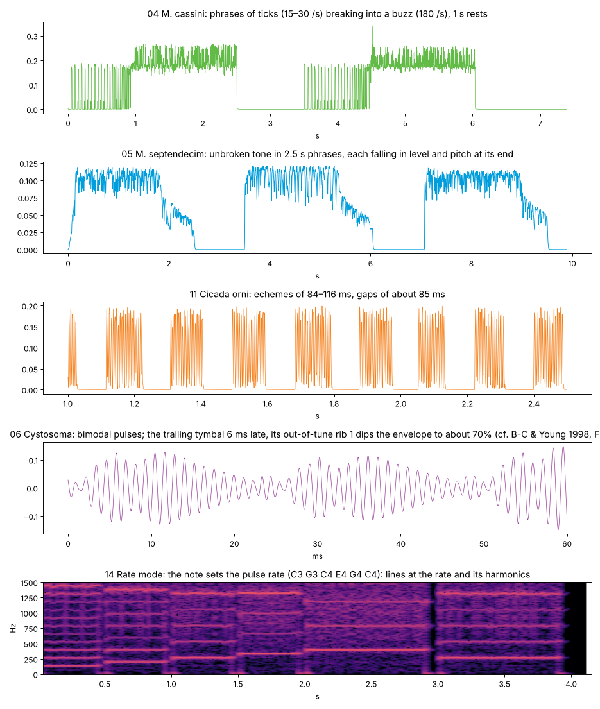
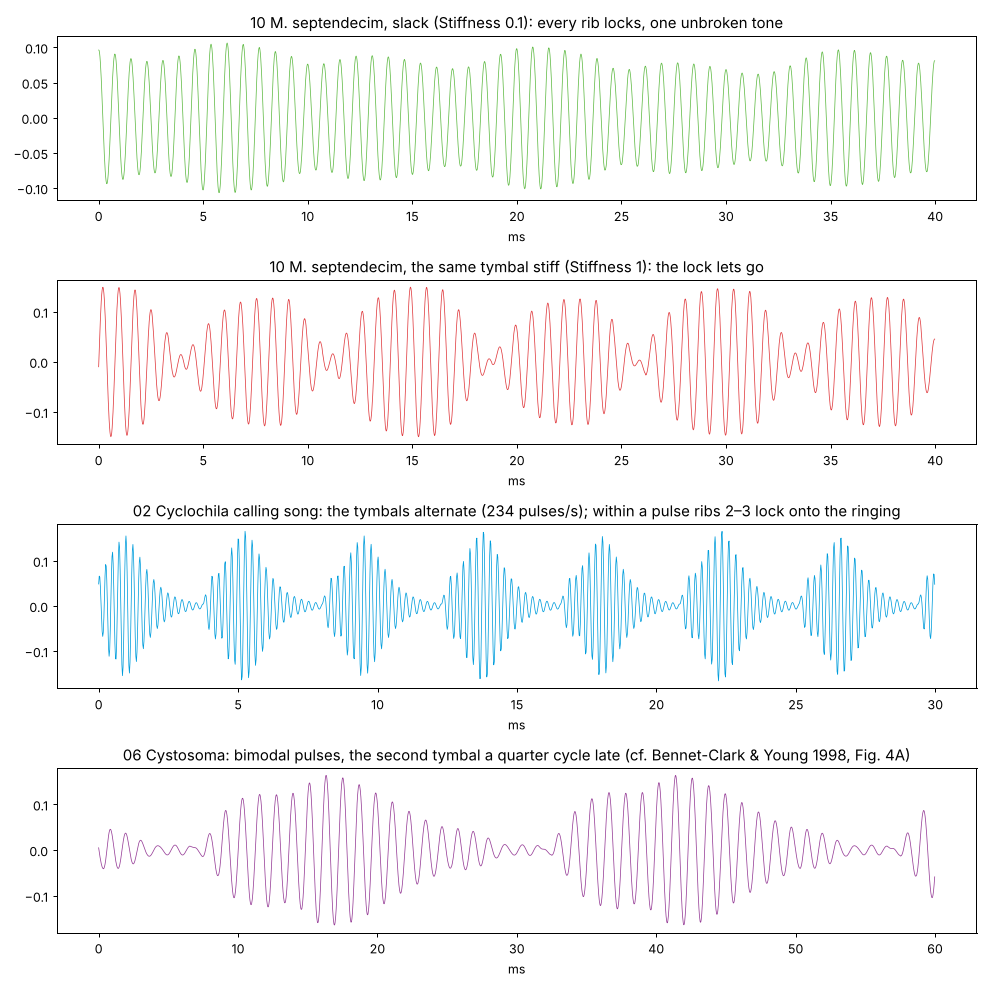
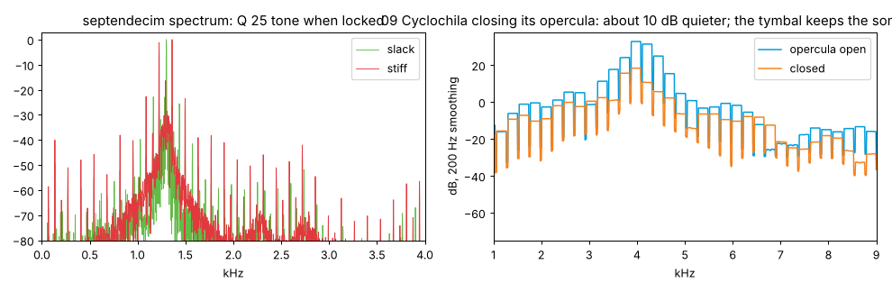

# tymbal · tests

Quick results per batch: tests, experiments and pictures. Pictures live in `docs/tests/`. Run the
tests with `node tests/engine-test.js`.

**Now: 72 engine tests passing** (about 2 s). Benchmark: `node tools/perf.js`.

## Batch 05 · cost

`node tools/perf.js`, each scenario in a fresh Node process (running them one after another in one
process let one scenario's JIT state move another's number by up to 2×), best of two runs of 3 s,
one 2.8 GHz Xeon core, 48 kHz:

| Scenario | Core | IN clicks/s | Strokes/s |
|---|---|---|---|
| Silent (no notes) | 0.08% | 0 | 0 |
| 1 voice, defaults | 2.44% | 702 | 234 |
| 1 voice, *Cyclochila* calling song | 2.28% | 702 | 234 |
| 1 voice, *M. septendecim*, locked tone | 2.51% | 339 | 92 |
| 1 voice, *M. cassini* phrase | 2.41% | 903 | 100 |
| 1 voice, Open body | 2.73% | 468 | 117 |
| 1 voice, Async | 2.49% | 654 | 392 |
| 1 voice, Rate mode at C6 | 2.36% | 2093 | 1047 |
| 1 voice, worst case | 4.44% | 26245 | 1177 |
| 8 voices, defaults | 6.02% | 5615 | 1871 |
| 8 voices, *Cyclochila* calling song | 7.54% | 5615 | 1871 |
| 8 voices, worst case | 22.14% | 207464 | 9332 |

Worst case: 24 ribs 0.05 ms apart, 600 strokes per second per tymbal, every rib clicking out, both
cavity modes loud, a slack tymbal so every rib runs the lock. One voice is mostly fixed cost (the
decimation filter and controls, about 1.9%); each further voice adds about 0.5%. Clicks cost about
0.8 µs each. **Poly gets all 8 voices.** Repeat runs agree within about 0.5 points.

Found and fixed:

- *M. cassini*'s phrase cost 5.9%, more than twice the others. Its 1 s rests kept the voice running
  while its resonators decayed into subnormal numbers, which are slow on x86 (continuous song or
  no rest: 2.6–2.9%). States below −300 dB are now set to zero, and a voice whose tymbals and body
  are all at zero skips its per-sample loops: 2.4%.
- `voicePitch` built a closure and three small arrays every block, and the hot paths used
  callbacks and `for … of`. All replaced by plain code. Minor collections in 20 s of four busy
  voices: 108 → 81 (one busy voice 17, silence 1; Syrinx 22 and Dolphin 20 with four voices on
  their defaults). What is left follows the click rate: V8 boxing the doubles returned from small
  per-event calls. The C++ port does not allocate.

## Batch 04 · muscles and song

How it is built:

- One muscle clock per voice: each cycle strokes the left tymbal, then the right one Lr phase into
  the same cycle. It carries the song (echemes and phrases with their intro and fall), Rubato,
  Jitter and the drive. Before, each tymbal kept its own clock.
- Rate mode: the note sets the stroke rate (each tymbal at half the note when both alternate);
  the body sits at the Carrier knob.
- Async: one command per burst; even cycles inside it, force running down 60% across it.
- Aftertouch opens the opercula.
- Rubato's default is now 0: in Rate mode it bends the pitch.

Experiments:

- *Cystosoma* gave a two-step rise, not two humps: the preset timed its ribs like the
  muscle-stimulated preparation (rib 2 4–6 ms after rib 1). In calling song (Fig. 12 of
  Bennet-Clark & Young 1998) the leading tymbal's ribs 2–3 follow two cycles after rib 1, and the
  dip comes when the trailing tymbal's out-of-tune rib 1 lands on the ringing abdomen. With Lead
  1.7 ms, rib 1 +5 st at full level and Stiffness 0.4, 68 of 69 pulses are bimodal (dip to about
  70%). Looser (Stiffness 0.5–0.6) only 70–85% are.
- Rate mode measured 14 cents flat at Heat 38 °C. The stroke clock was exact (261.626 /s at every
  temperature); at 38 °C the ribs sit closer and 617 of 779 lock, and locked ribs snap to the
  4.3 kHz carrier's phase grid, so each pulse lands up to half a carrier period off. The test now
  checks the stroke clock, and the sound with the lock off. For playing tunes, a stiffer tymbal
  keeps pulses even (open for the listening round).

Tests:

| What | Paper | Engine |
|---|---|---|
| *Cystosoma*: second tymbal late | 5–7 ms (a quarter cycle) | 6.05–6.41 ms ✓ |
| *Cystosoma*: bimodal pulses | two humps, 20–23 ms | 68 of 69 pulses bimodal, humps a median 5.5 ms apart; median 24.5 ms above 10% of the peak ✓ |
| *M. cassini* phrase | 15–30 pulses/s, then 170–200 | 22.9 /s, then 180 /s; silent rest; the next phrase starts slow again ✓ |
| *C. orni* echemes | 84–116 ms, gaps 84–93 ms, 4.7 /s | 87–112 ms, gaps 82–91 ms, 5.4 /s ✓ |
| *M. septendecim* phrase end | drop in level and pitch | Fall 1: −374 cents (target 4 st), −14.5 dB ✓ |

Also: an echeme shorter than a cycle sounds one stroke (Ticks) ✓; Rate mode within 0.05 cents of
the note at C3, C4 and G4, body at the Carrier knob, Heat leaves the rate alone, one tymbal runs at
the note, default Jitter within 2.6 cents on average ✓; Async force 1, 0.85, 0.7, 0.55 per burst ✓;
Sync at 120 bpm snaps a 0.188 s echeme period to a third of a beat, ignoring Rubato ✓; Jitter 0.5
varies strokes by 14.5% while the average holds within 0.7% ✓; Rubato 1 drifts the tempo (0.5 s
windows differ by 12%) ✓; aftertouch +11.9 dB from shut opercula ✓; same output at buffer sizes 1,
64 and 999 with phrases, Rubato, Jitter, Async and Rate mode ✓.

Closed from batch 02: *M. cassini*'s strokes overlap in the buzz. Young & Josephson's myograms
show the muscles alternating strictly at 90 Hz in the final portion (pulses 5.5 ms apart), and
each compound pulse lasts about 9 ms, so the two tymbals' pulses overlap there; each still fits its
own 11.1 ms cycle. The engine keeps that.

Renders, 2–6% of real time each:

## Batch 03 · body and lock

How it is built:

- Two tymbals per voice drive a body: a complex one-pole at the carrier plus two weak cavity modes
  and a low-pass (Helmholtz), or nothing (Open). Lr phase, Pair, Asym and Spread place and shade
  the second tymbal.
- The click's nonlinear start moved into a per-click transient. Applied to the whole resonator, a
  coherent train sat a semitone flat; now it merges after about 4 cycles and leaves pitch alone.
- The lock: half a period before each rib, the body's phase predicts the nearest in-phase moment;
  the rib is pulled there by at most ½ period × (1 − Stiffness), if the body is still at ¼ of its
  peak since the last click.
- The pitch keeper holds locked tones on the note (see below).

Experiments before the tests (*M. septendecim*, *Cyclochila*, *M. cassini*):

- *M. septendecim* locked 627 of 634 ribs into one tone at once, but sat 11 cents flat. The click
  transient caused 9 of them: without it, and without rib tilt, it was within 1 cent.
- Aiming the lock early by the whole transient lag overshot to +6 cents; the drift depends on the
  transient, tilt, Qs and spacing together, so no constant fixes it. Added a pitch keeper that reads
  the body's phase advance per block, acting only while half the recent ribs lock. Now +0.5 cents.
- *Cyclochila* locked only 17% of its ribs: the gate compared with a 30 ms peak, usually an earlier
  pulse's, while the body was still building. The paper's rule is the preceding pulse: the peak now
  restarts at every click. 40% of all ribs, 60% of ribs 2–3, lock at Stiffness 0.3.
- *M. cassini*'s sub-pulses ran together through a Q 6 body (dips only to 35–45%). Its song is
  broadly tuned (overall Q 5), so its preset uses body Q 3 and tymbal Q 4: dips to about 15%.

Tests:

| What | Paper | Engine |
|---|---|---|
| Tymbal Q 9.3 into air sac Q 3.4 | 12.5 (Young & Bennet-Clark 1995, Table 1) | 9.9: sharper than the tymbal (9.0) and the sac (4.1) alone, but a passive chain cannot ring longer than its longer-ringing part, so 12.5 is out of reach |
| Three clicks two cycles apart | one long smooth pulse (Bennet-Clark & Young 1992, Fig. 14) | smooth, no dip ✓ |
| Three clicks in antiphase | double-humped (Fig. 15) | dips to 28% ✓ |
| Clicks three cycles apart | sidebands at the carrier ± 1.45 kHz (Fig. 16F) | a lobe at +0.94 kHz, 25 dB above the null: there, but the resonators' skirts pull it in |
| *M. septendecim* | unbroken tone, Q 25, 20 dB bandwidth ≤ 0.5 kHz, harmonic 30 dB down | 580 of 634 ribs locked, periods within 1.4%, envelope never below 52%, 200 Hz, 56.9 dB down ✓ |
| Same tymbal, stiff | pulsed | none locked, periods off by up to 70% ✓ |
| *M. cassini* | about 9 sub-pulses, rising and falling sharply | 9 per stroke, none locked ✓ |
| *Cyclochila* | coherent ribs | 60% of ribs 2–3 locked; rib 1 follows the other side's pulse after it has died away ✓ |
| Opercula closed (model) | 4.33 → 3.54 kHz, Q 7.8 → 5.2, about 10 dB down | × 0.813, Q 7.7 → 5.0, −9.5 dB ✓ |
| Thick eardrums | Q 25 in *septendecim* | Membrane 1: Q × 3.9 ✓ |

Also: Carrier mode within 0.48 cents on *septendecim* (pitch keeper) ✓; tymbals alternate at Lr
phase 0.5 and sit a quarter cycle apart at 0.25 ✓; Pair Right ✓; Spread ✓; Tune +3 st and Scatter 1
both roughen the tone (envelope floor 52% → 30% and 15%) ✓; same output at buffer sizes 1, 64 and
777 with Poly, the lock and the keeper ✓.

Found in the renders' spectra: closing the opercula during song does not lower its pitch.
The air sac's own resonance drops to 0.82×, but the tymbal keeps driving at 4.2 kHz, so the song
gets about 10 dB quieter instead. That fits Young & Bennet-Clark's conclusion that the tymbal is a
major determinant of song frequency.

Still open from batch 02: *M. cassini*'s two tymbals at 90 Hz each give strokes 5.5 ms apart, and
9 sub-pulses take about 9 ms, so with both tymbals the strokes overlap. Preset 04 plays both.
(Closed in batch 04.)

Renders, 2–5% of real time each:

## Batch 02 · tymbal core

One tymbal, no body yet: what comes out is the bare tymbal, as in the papers' abdomenless and
open-cicada preparations.

How it is built:

- The tymbal is one complex one-pole resonator that retunes as ribs buckle and pop out, so its
  ringing carries over from one state to the next. Each click adds a phasor at its exact
  sub-sample time.
- Click shape: the phasor starts at phase 1.3π, so the output opens with a short, small
  rarefaction and then a full compression, as in Fig. 3B of Bennet-Clark 1997. Click amplitude is
  set so the compression peak equals the rib's level.
- Nonlinear start: the resonator turns 6% slower at full click amplitude, so a click starts low
  and rises as it decays.
- Rib table: rib 2 sits on the carrier, rib 1 at First, later ribs fall along Tilt × u² and fade
  along Taper × u² (u from rib 2 to the last rib). The square law fits *Cyclochila*'s ribs 3 and 4
  from rib 2 to within 0.05 st. Q follows 1/f from Tymbal Q at the carrier.
- Muscle: one stroke per cycle at Rate × Heat. Ribs that would buckle after the OUT moment
  (Hold) are not recruited. Effort (velocity × envelope, sampled at each stroke) sets click level,
  and recruitment follows √effort.
- With middle C the carrier is C8 = 4186 Hz, which is *Cyclochila*'s rib 2 (4.19 kHz).

Tests against Table 2 of Bennet-Clark 1997 (unloaded tymbal, ribs 4 ms apart so each is measured
alone; frequency over cycles 3–10, after the nonlinear start):

| | Paper | Engine | Error |
|---|---|---|---|
| Rib 1 | 4.37 kHz, level 1 | 4.353 kHz, 1.00 | 0.4%, 0 dB |
| Rib 2 | 4.19 kHz, 1.01 | 4.170 kHz, 1.00 | 0.5%, −0.1 dB |
| Rib 3 | 3.92 kHz, 0.83 | 3.890 kHz, 0.77 | 0.8%, −0.7 dB |
| Rib 4 | 3.17 kHz, 0.39 | 3.159 kHz, 0.37 | 0.3%, −0.4 dB |
| OUT | 6.54 kHz, 0.34 | 6.55 kHz, 0.32 | 0.2%, −0.6 dB |
| Q | about 10 IN, about 6 OUT, rising as f falls | 9.4, 9.7, 10.4, 12.7; OUT 6.6 | Q·f within 5% |

Other tests:

- IN pulse: rarefaction 0.31 of the compression, 83 µs before it. ✓
- Frequency rises 162 Hz through the decay (4212 → 4374 Hz; the paper: 150–350 Hz). ✓
- Song speed (117 Hz, ribs 0.6 ms apart): finite, peak 0.12. ✓
- Effort: a loud stroke recruits 4 ribs, a soft one 2. ✓
- Ribs after the OUT moment do not buckle (2 of 4 in a 5 ms hold). ✓
- Out clicks 1: four ribs pop out, then the plate (5 clicks). ✓
- Heat 20 → 35 °C: rib spacing 1.846× faster, 30 → 56 strokes in 0.5 s, carrier unchanged. ✓
- Carrier mode: middle C is 4186.01 Hz; above 16 kHz the carrier drops an octave. ✓
- Same output at buffer sizes 1, 64 and 1000, with two overlapping notes. ✓
- Release ends in silence and the engine goes idle. ✓

Problems found and fixed:

- The first stroke after a note on recruited one rib fewer than asked: the envelope is still
  rising. Kept, since it is what a muscle would do; the Table 2 test reads the second stroke.
- *M. cassini* showed 6 sub-pulses instead of 9: with Hold 0.5 the muscle let go after 5.5 ms of
  its 11 ms cycle. Its presets use Hold 0.92.

Open for batch 04: in the fast part of a *M. cassini* phrase (180 pulses/s from two alternating
tymbals, 5.5 ms apart), 9 sub-pulses about 1 ms apart do not fit. Either the two tymbals' pulses
overlap or the final portion recruits fewer ribs; the paper's isolated pulses come from the slow
start and protest song.

Renders (`node tools/render-presets.js`), 1–6% of real time each in JavaScript:

Heat on *M. cassini*: sub-pulses and strokes speed up, the 6 kHz carrier does not move.

