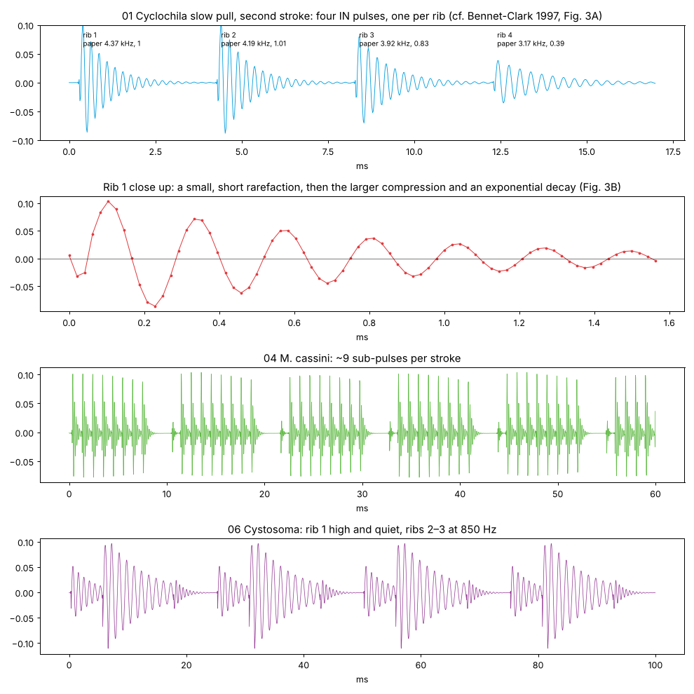
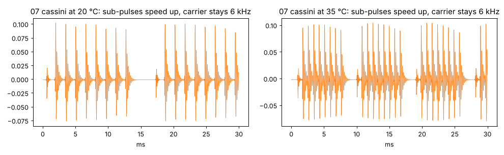

# tymbal · tests

Quick results per batch: tests, experiments and pictures. Pictures live in `docs/tests/`. Run the
tests with `node tests/engine-test.js`.

**Now: 26 engine tests passing** (about 0.3 s).

## Batch 02 · tymbal core

One tymbal, no body yet: what comes out is the bare tymbal, as in the papers' abdomenless and
open-cicada preparations.

How it is built:

- The tymbal is one complex one-pole resonator that retunes as ribs buckle and pop out, so its
  ringing carries over from one state to the next. Each click adds a phasor at its exact
  sub-sample time.
- Click shape: the phasor starts at phase 1.3π, so the output opens with a short, small
  rarefaction and then a full compression, as in Fig. 3B of Bennet-Clark 1997. Click amplitude is
  set so the compression peak equals the rib's level.
- Nonlinear start: the resonator turns 6% slower at full click amplitude, so a click starts low
  and rises as it decays.
- Rib table: rib 2 sits on the carrier, rib 1 at First, later ribs fall along Tilt × u² and fade
  along Taper × u² (u from rib 2 to the last rib). The square law fits *Cyclochila*'s ribs 3 and 4
  from rib 2 to within 0.05 st. Q follows 1/f from Tymbal Q at the carrier.
- Muscle: one stroke per cycle at Rate × Heat. Ribs that would buckle after the OUT moment
  (Hold) are not recruited. Effort (velocity × envelope, sampled at each stroke) sets click level,
  and recruitment follows √effort.
- With middle C the carrier is C8 = 4186 Hz, which is *Cyclochila*'s rib 2 (4.19 kHz).

Tests against Table 2 of Bennet-Clark 1997 (unloaded tymbal, ribs 4 ms apart so each is measured
alone; frequency over cycles 3–10, after the nonlinear start):

| | Paper | Engine | Error |
|---|---|---|---|
| Rib 1 | 4.37 kHz, level 1 | 4.353 kHz, 1.00 | 0.4%, 0 dB |
| Rib 2 | 4.19 kHz, 1.01 | 4.170 kHz, 1.00 | 0.5%, −0.1 dB |
| Rib 3 | 3.92 kHz, 0.83 | 3.890 kHz, 0.77 | 0.8%, −0.7 dB |
| Rib 4 | 3.17 kHz, 0.39 | 3.159 kHz, 0.37 | 0.3%, −0.4 dB |
| OUT | 6.54 kHz, 0.34 | 6.55 kHz, 0.32 | 0.2%, −0.6 dB |
| Q | about 10 IN, about 6 OUT, rising as f falls | 9.4, 9.7, 10.4, 12.7; OUT 6.6 | Q·f within 5% |

Other tests:

- IN pulse: rarefaction 0.31 of the compression, 83 µs before it. ✓
- Frequency rises 162 Hz through the decay (4212 → 4374 Hz; the paper: 150–350 Hz). ✓
- Song speed (117 Hz, ribs 0.6 ms apart): finite, peak 0.12. ✓
- Effort: a loud stroke recruits 4 ribs, a soft one 2. ✓
- Ribs after the OUT moment do not buckle (2 of 4 in a 5 ms hold). ✓
- Out clicks 1: four ribs pop out, then the plate (5 clicks). ✓
- Heat 20 → 35 °C: rib spacing 1.846× faster, 30 → 56 strokes in 0.5 s, carrier unchanged. ✓
- Carrier mode: middle C is 4186.01 Hz; above 16 kHz the carrier drops an octave. ✓
- Same output at buffer sizes 1, 64 and 1000, with two overlapping notes. ✓
- Release ends in silence and the engine goes idle. ✓

Problems found and fixed:

- The first stroke after a note on recruited one rib fewer than asked: the envelope is still
  rising. Kept, since it is what a muscle would do; the Table 2 test reads the second stroke.
- *M. cassini* showed 6 sub-pulses instead of 9: with Hold 0.5 the muscle let go after 5.5 ms of
  its 11 ms cycle. Its presets use Hold 0.92.

Open for batch 04: in the fast part of a *M. cassini* phrase (180 pulses/s from two alternating
tymbals, 5.5 ms apart), 9 sub-pulses about 1 ms apart do not fit. Either the two tymbals' pulses
overlap or the final portion recruits fewer ribs; the paper's isolated pulses come from the slow
start and protest song.

Renders (`node tools/render-presets.js`), 1–6% of real time each in JavaScript:

Heat on *M. cassini*: sub-pulses and strokes speed up, the 6 kHz carrier does not move.

